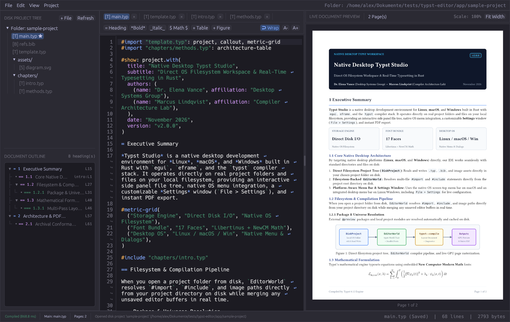

# Typst Local Editor

Currently this project is a proof of concept of the usecase scenario. It is currently not even in an alpha state. DO NOT USE.

## Goal

The goal of the project is to build a typst local desktop editor with the following features:

- [ ] Runs on Linux, MacOS and Windows
- [x] Live preview of the changes
- [x] Realtime collaboration on the same project with P2P technology (-> no custom server required)
- [x] Typst compiler automatically downloads external packages
- [x] Easy PDF export with multiple formats
- [ ] Clear display of errors and warnings
- [ ] Add MCP support for external agents
- [x] Project outliner
- [x] Modern UI design
- [ ] build only with modular moveable panels
- [ ] support multiple typst preview render methods (canvas and pdf)
- [ ] enable text selection in the preview and jump at this position in the code

## Screenshot



## Important things to do

- [ ] Cleanup the code
- [ ] Make the code more testable
- [ ] Split the code into smaller chunks
- [ ] Fix various UI gliches and unintuitive UI designs
- [ ] Add UI scaling support for the entire application (f.e. right click needs more space between options)
- [ ] Rework the look and feel of the tab system

## Development

### How to build

```sh
cd app
cargo build --release 
```

## License

GNU General Public License v3.0

## AI USE

Currently this project is a test of how good artcraft craft anything app works with google antigravity. Both were used with a blank starting point.

Currently this project is more a proof of concept, because I need such a project and could not find an existing working project, that simply does what I need it to do. So I am testing, how fast those tools can build a simple text editor with some extra features.
